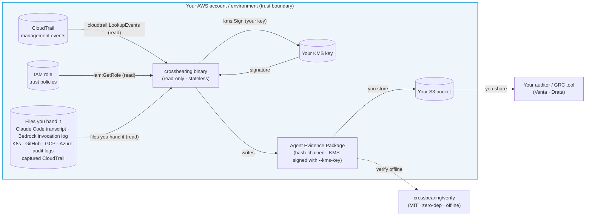

# Data flow & trust boundaries

The security-review version of "what touches what." The one fact that governs the
rest: **everything happens inside your account, and no customer data crosses a
boundary to crossbearing.**

## What this shows

- **Inputs are reads, inside your account.** CloudTrail and IAM trust policies via
  the [read-only role](../../deploy/readonly-role/); any other audit logs are files
  *you* export and hand over. The only access opened to crossbearing is the
  [read-only role](../../deploy/readonly-role/): one named crossbearing principal may
  assume it, only with the external id you choose, for sessions of at most one hour,
  to make these same reads (plus `kms:Sign` with your one named key, only if you
  configure a signing key). Delete the role to revoke it.
- **The join runs locally.** Correlating claims against records happens in the
  binary's process — in your account or on your operator's machine. No data is sent
  out to be processed.
- **Output is a local file; the key stays in your KMS.** The evidence package is
  hash-chained and, only with `--kms-key`, signed with **your** KMS key; without it
  the package is *explicitly* unsigned. The binary writes it to the `--pack` path on
  whichever machine runs it. The role grants no write to your storage, so a package
  produced through the cross-account role lands on the operator's machine, not in
  your account. Crossbearing never holds the key: the role grants `kms:Sign` on that
  one key ARN, only when one is configured, with no `kms:Decrypt` and nothing that
  exports key material.
- **No vendor boundary is crossed by data.** There is no crossbearing backend, API,
  or datastore in this diagram — because there isn't one. On the crossbearing side
  there is the binary and, when you deploy the read-only role, the one crossbearing
  IAM principal that role trusts to assume it (with your external id).
- **Trust is transferable.** Your auditor verifies the package with the separate,
  MIT-licensed, zero-dependency verifier — confirming the chain and signature
  **without trusting crossbearing's build or remaining a crossbearing customer.**

## The boundaries, named

| Boundary | Crosses it | Direction | Protection |
|---|---|---|---|
| Your account ⇄ AWS APIs | LookupEvents / GetRole / Sign | read (+ sign) | TLS; least-privilege role; external id |
| crossbearing binary ⇄ your data | nothing leaves | — | read-only by architecture; stateless |
| You ⇄ auditor | the evidence package *you* choose to share | outbound, your control | your decision; package is signed + verifiable |

See the [threat model](../threat-model.md) for the STRIDE analysis per boundary.
